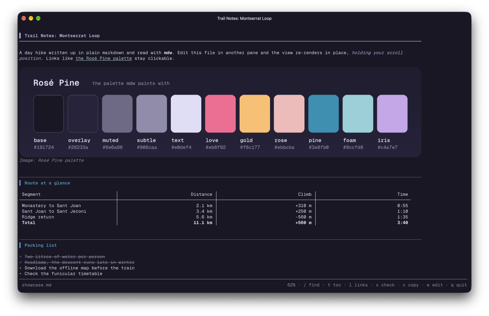
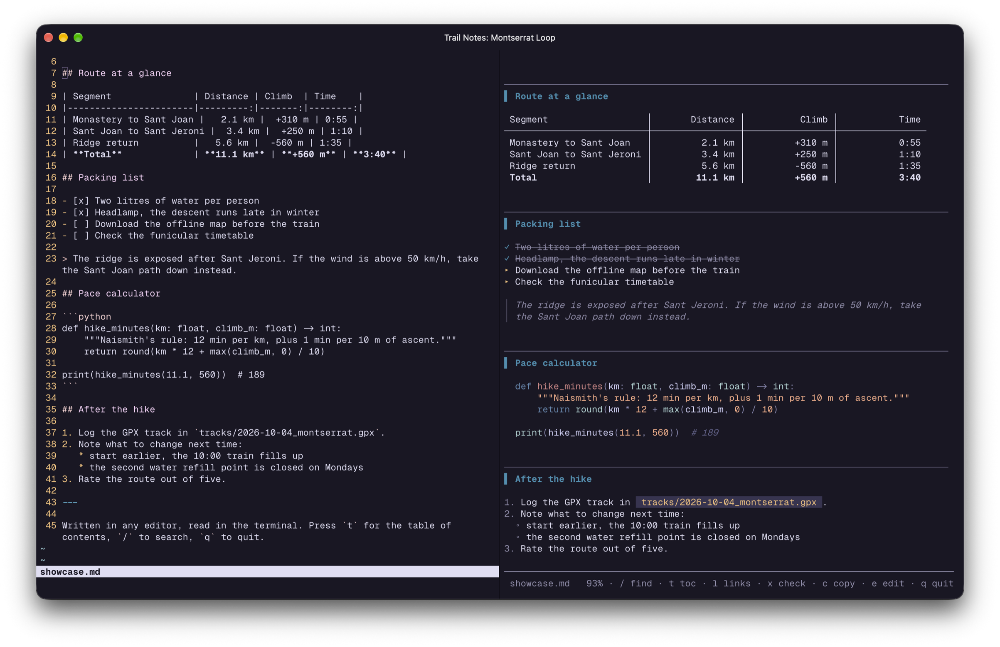

# mdw

mdw is a live markdown viewer for the terminal: it re-renders when the file changes and keeps you where you were reading.





## Install

```sh
brew install glow fswatch
git clone https://github.com/RobertJLora/mdw.git
cd mdw
./install.sh
```

`install.sh` copies mdw into `~/.local` (`bin/mdw`, `lib/mdw/`, `share/mdw/`), lists any missing dependencies, and tells you if `~/.local/bin` is not on your `PATH`. Use `./install.sh --prefix /usr/local` for another location and `./install.sh --uninstall` to remove it.

There is no Homebrew formula yet. On Linux, install glow and fswatch from your package manager and run the same script.

## Usage

```sh
mdw notes.md                 # view a file
mdw --split notes.md         # open it in a new Ghostty split to the right
mdw --window notes.md        # open it in a new Ghostty window
mdw notes.md | less -R       # piped: print the render once and exit
```

Keys:

| Key | Action |
| --- | --- |
| `j` `k`, arrows, wheel | scroll |
| `space` `b` | page down, page up |
| `d` `u` | half page down, up |
| `g` `G` | top, bottom |
| `/` | search; `n` `N` cycle, `Esc` clears |
| `t` | table of contents; type a number to jump |
| `l` | local `.md` files this doc links to; type a number to open one in a split |
| `x` | list the `- [ ]` tasks; type a number to tick or untick it in the file |
| `c` | copy a section to the clipboard as clean text |
| `e` | edit in this pane, opened at the section you are reading |
| `o` | open in your GUI editor |
| `r`, `Ctrl+C` | re-render now |
| `q` | quit |

## Live reload holds your place

When the file changes on disk, mdw re-renders the whole document and repaints at the same scroll offset. It does not jump to the top or the end, so you can keep reading while another program writes the file. Lines that changed get a marker in the right margin for about six seconds.

If you were already at the bottom, the view follows the new bottom instead, which suits logs and notes that grow at the end.

mdw watches the file with `fswatch` when it is installed and also checks the modification time every half second, so reload still works without fswatch, or after an editor replaces the file instead of writing it in place. Your scroll position is also saved per file, so reopening a document puts you back where you stopped.

## Images

A markdown image on a line of its own, ``, is drawn inline when the terminal supports kitty graphics Unicode placeholders: Ghostty and kitty. The image becomes part of the scrolling text, so it moves and clips with the page. Relative paths resolve against the markdown file. PNG files are sent as is; JPEG, GIF and HEIC are converted with `sips` on macOS or ImageMagick elsewhere.

In other terminals, inside tmux, or when piped, the image line shows its alt text instead. Set `MDW_IMAGES=0` to turn images off or `MDW_IMAGES=1` to force them on.

## Ghostty splits

The split screenshot above is the intended setup: an editor, a shell or a coding agent on the left, and mdw on the right showing the file it is writing.

`mdw --split FILE` and the `l` key use Ghostty's AppleScript support (Ghostty 1.3 or later on macOS) to split the current pane to the right and run mdw in it. macOS asks once for permission to let your terminal control Ghostty. Outside Ghostty, mdw prints the command and copies it to the clipboard so you can paste it into a split yourself.

## Configuration

All settings are environment variables.

| Variable | Default | Effect |
| --- | --- | --- |
| `MDW_THEME` | auto | `dark` or `light`; auto follows a pinned Ghostty theme, then the macOS appearance |
| `MDW_MAX_COLS` | `110` | maximum text width, so prose stays readable on wide panes |
| `MDW_COLS` | unset | exact text width, ignoring the cap |
| `MDW_MARGIN` | `0` | extra right-hand gutter in columns |
| `MDW_SCROLL_STEP` | `1.5` | lines per wheel tick or `j`/`k` press |
| `MDW_IMAGES` | auto | `0` off, `1` on |
| `MDW_IMG_MEDIUM` | file | `d` sends image bytes inline instead of a file path (needed over ssh) |
| `MDW_EDITOR` | `$VISUAL`, `$EDITOR`, micro, nano, vi | terminal editor for `e` |
| `MDW_GUI_EDITOR` | `open` or `xdg-open` | command for `o` |
| `MDW_GLOW_STYLE` | bundled Rose Pine | path to another glamour style JSON |
| `MDW_LINK_ROOT` | unset | a folder to search when a linked `.md` path is not found relative to the doc |
| `MDW_FOLLOW` | `0` | `1` keeps a piped mdw running and prints a new render on every change |
| `MDW_EMOJI` | `1` | `0` leaves `:shortcode:` emoji as text |
| `MDW_LINKS` | `1` | `0` turns off clickable OSC 8 links |
| `MDW_MAX_BYTES` | `1048576` | files larger than this render a truncated head |

The colors are Rosé Pine: the dark variant on dark backgrounds and Dawn on light ones. The two style files live in `share/mdw/styles/`.

## Requirements

* macOS (Linux should work but is untested)
* zsh and Python 3.8 or later
* [glow](https://github.com/charmbracelet/glow) 2.x for styled output
* [fswatch](https://github.com/emcrisostomo/fswatch), recommended
* a truecolor terminal; Ghostty or kitty for inline images
* Ghostty 1.3 or later for `--split`, `--window` and the `l` key

## License

MIT. See [LICENSE](LICENSE).
