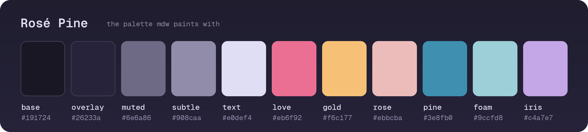

# Trail Notes: Montserrat Loop

A day hike written up in plain markdown and read with **mdw**. Edit this file in another pane and the view re-renders in place, *holding your scroll position*. Links like [the Rosé Pine palette](https://rosepinetheme.com) stay clickable.



## Route at a glance

| Segment               | Distance | Climb  | Time    |
|-----------------------|---------:|-------:|--------:|
| Monastery to Sant Joan |   2.1 km |  +310 m | 0:55 |
| Sant Joan to Sant Jeroni |  3.4 km |  +250 m | 1:10 |
| Ridge return          |   5.6 km |  -560 m | 1:35 |
| **Total**             | **11.1 km** | **+560 m** | **3:40** |

## Packing list

- [x] Two litres of water per person
- [x] Headlamp, the descent runs late in winter
- [ ] Download the offline map before the train
- [ ] Check the funicular timetable

> The ridge is exposed after Sant Jeroni. If the wind is above 50 km/h, take the Sant Joan path down instead.

## Pace calculator

```python
def hike_minutes(km: float, climb_m: float) -> int:
    """Naismith's rule: 12 min per km, plus 1 min per 10 m of ascent."""
    return round(km * 12 + max(climb_m, 0) / 10)

print(hike_minutes(11.1, 560))  # 189
```

## After the hike

1. Log the GPX track in `tracks/2026-10-04_montserrat.gpx`.
2. Note what to change next time:
   * start earlier, the 10:00 train fills up
   * the second water refill point is closed on Mondays
3. Rate the route out of five.

---

Written in any editor, read in the terminal. Press `t` for the table of contents, `/` to search, `q` to quit.
